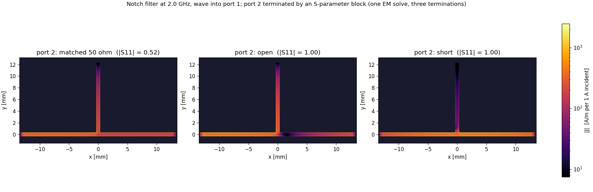
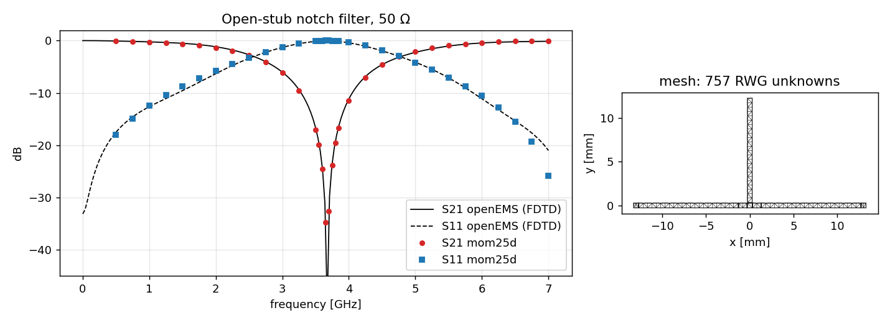
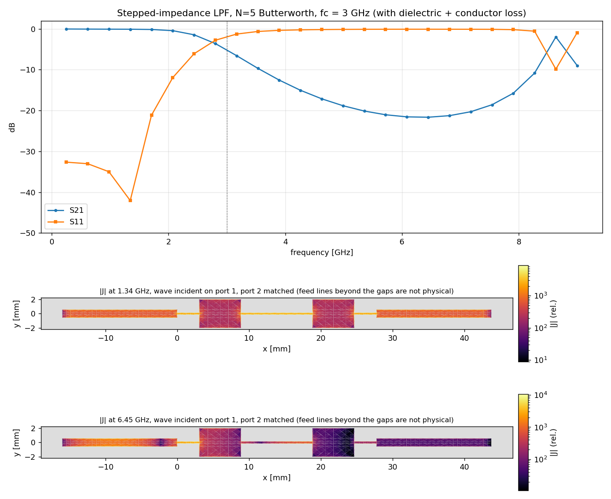

# mom25d — 2.5D method of moments for planar RF circuits

A compact Python implementation of the mixed-potential integral equation
(MPIE) method of moments for microstrip circuits: planar conductors on a
grounded dielectric substrate, with exact layered-media Green's functions,
RWG basis functions and de-embedded S-parameters.

```
air                                 z > h
─── conductors (zero thickness) ─── z = h
substrate  eps_r, tanδ              0 < z < h
═══ ground ═══════════════════════  z = 0
```

With `sigma` set, conductor loss covers both the strip (surface impedance) and
the ground plane (quasi-static return current, `Substrate(ground_loss=True)`,
the default). The ground is otherwise treated as a perfect conductor.
Supported beyond that:

- multilayer stackups, with copper on any interface and an air or PEC top;
- vias between any two layers or to ground;
- via-stitched copper pours.

See "Multilayer stackups" and "Vias and copper pours".

## Quick start

The solver lives in `Engine/` (package `mom25d`, tests, ODB++ tools);
each example model in `Models/<model>/` with `geometry/` (the layout as a
Python module, or CAD input), `analysis/` (scripts) and `results/`
(their outputs).

```bash
cd mom25d/Engine
pip install -e '.[fast]'           # numpy / scipy / matplotlib (+ numba); extras odb, tri, dxf
python -m pytest                   # ~4 min validation suite
cd ..
python Models/notch_filter/analysis/vs_openems.py
python Models/stepped_impedance_lpf/analysis/sweep.py
```

```python
import numpy as np
from mom25d import Layout, Solver, Substrate, GHz, mm

W = 1.137 * mm                                     # 50 Ω on 0.508 mm RO4003C
lay = Layout()
lay.add_rect(-W/2 - 2*mm, -W/2, W/2 + 2*mm, W/2)   # line section at the tee
lay.add_rect(-W/2, W/2, W/2, W/2 + 6.6*mm)         # open stub
lay.add_port("P1", ref=(-W/2 - 2*mm, 0), direction="-x", width=W, length=15*mm)
lay.add_port("P2", ref=( W/2 + 2*mm, 0), direction="+x", width=W, length=15*mm)

mesh = lay.mesh(max_cell=0.5*mm, edge_cell=0.08*mm)
sol  = Solver(mesh, Substrate(eps_r=3.55, h=0.508*mm, tand=0.0027, sigma=5.8e7))
res  = sol.sweep(np.linspace(1, 10, 37) * GHz)

S50 = res.renormalize(50)          # (F, P, P)
res.write_touchstone("stub.s2p")   # 50 Ω Touchstone
res.eeff, res.z0_line              # per-port ε_eff and line impedance vs f

# surface current for a wave into port 1 with port 2 matched
res = sol.sweep(freqs, keep_currents=True)
J = sol.current_density(res.matched_currents(fi, 0)[:, None])
```

A port is a feed line that `add_port` adds to the layout itself. It runs from
the reference plane `ref` outward along `direction` for `length`, and ends in
a delta-gap source near its open end. The S-parameters are de-embedded to
`ref`.

## Multilayer stackups

```
air (or PEC cover, top="pec")
─── "top"   ───  interface 2
layer 2  (t, eps_r, tand)
─── "inner" ───  interface 1
layer 1
═══ "gnd" ════  PEC ground, z = 0
```

```python
from mom25d import Stackup, Dielectric

st = Stackup([Dielectric(0.254*mm, 3.66, 0.0037),       # bottom layer, on the ground
              Dielectric(0.254*mm, 3.66, 0.0037)],
             metals={"inner": 1, "top": 2},              # name -> interface (top of layer k)
             top="air", sigma=5.8e7)

lay = Layout()
lay.add_rect(-3*mm, -WT/2, 0, WT/2, layer="top")
lay.add_rect(0, -WI/2, 3*mm, WI/2, layer="inner")
lay.add_port("P1", (-3*mm, 0), "-x", WT, 12*mm, layer="top")
lay.add_port("P2", ( 3*mm, 0), "+x", WI, 12*mm, layer="inner")
lay.add_via(0, 0, drill=0.3*mm, pad=0.6*mm, top="top", bottom="inner")   # or bottom="gnd"
res = Solver(lay.mesh(0.2*mm, edge_cell=0.05*mm), st).sweep(freqs)
```

- Every `add_*` takes `layer=`. The default `"top"` matches
  `Substrate`, which is the one-layer `Stackup.microstrip`. Ports can sit on
  any layer, including buried lines and stripline under a PEC cover.
- **Vias** name the layers they connect: `top=`, `bottom=` (`"gnd"` is the
  ground plane). Pads are added on both end layers. On layers in between, a
  via connects wherever there is copper at its position. To pass through
  without connecting, cut an antipad. The solver splits a via into vertical
  segments between the layers it connects, one unknown each. A segment
  drains the hole triangles of its upper layer and feeds those of its lower
  layer. `Pour(..., layer=, via_to=)` stitches a pour on any layer to any
  other layer.
- **Green's functions** (`layered.py`): transmission-line form (Michalski &
  Zheng) for every pair of metal levels:
  - G̃_A = V^h, K̃^φ = (V^e + k₀²V^h)/k_ρ², and the line voltage
    −∫₀^z E_z dz = Σ_k ΔV^e_k/u_k².
  - Each kernel's leading c·e^{−jkR}/(4πR) term, R = √(ρ² + Δz²), is
    extracted and integrated in closed form over the source triangles.
    `potential_integrals` handles observers off the source plane.
  - The remainder is tabulated as before.
  - With one layer the result equals `GroundedSlabGreens` to machine
    precision, and the solver then uses the original kernels, so
    single-layer results are bit-identical.
- Couplings between layers in assembly use 3D distances to pick
  near/mid/far rules. Vertical via currents stay quasi-static: partial
  inductances with ground images, no mutual inductance to horizontal
  currents.
- Validation (`Engine/tests/test_multilayer.py`):
  - two air layers vs exact images: < 1e-6;
  - substrate split into two identical layers vs one slab: |ΔS| 3e-8;
  - centred stripline vs Cohn's exact formula: ε_eff 0.1 %, Z₀ ≈ 1 %;
  - top microstrip → via → buried line vs openEMS
    (`Engine/tests/data/ref_multilayer_openems.py`): S21 phase within 0.4–0.9° from
    1 to 15 GHz, |S11| < −24 dB in both.

### Inner ground planes

```
air
─── "top"   ───  interface 3     microstrip over L2
layer 3
═══ "L2"  ════  solid PEC plane (planes={"L2": 2})
layer 2
─── "inner" ───  interface 1     stripline between gnd and L2
layer 1
═══ "gnd" ════  PEC ground
```

```python
st = Stackup([Dielectric(0.254*mm, 3.66)] * 3, {"inner": 1, "top": 3}, planes={"L2": 2})
lay = Layout()
lay.add_plane("L2")                       # planes are not meshed
...
lay.add_via(0, 0, 0.3*mm, 0.6*mm, top="top", bottom="inner")        # passes L2 (antipad)
lay.add_via(1*mm, 1*mm, 0.3*mm, top="L2", bottom="gnd")              # stitching via
lay.add_via(2*mm, 0, 0.3*mm, top="top", bottom="gnd", connect=("L2",))  # ground via tied to L2
```

- A solid plane splits the stack into **sections** that do not couple:
  `SectionedGreens` tabulates each section as a stack of its own (ground =
  the plane below, cover = the plane above) and returns zero kernels across
  a plane. Port voltages, heights and β estimates refer to the plane below
  the line.
- Vias are the only coupling through a plane. A via passes every plane it
  crosses (through an antipad, not modelled otherwise) unless it lists it
  in `connect=`; vias can end on planes (no pad, no charge there).
- A via's vertical current is cut into one piece per section
  (`via_impedance`). Under an open (air) top: quasi-static inductance with
  the image in the plane below, as before. Between two PEC planes (also a
  `top="pec"` cover): parallel-plate modes, ωμ l_a l_b/(4d)·H₀⁽²⁾(kρ) for
  the TEM radial wave plus the evanescent TM_n series. The TEM term's real
  part is power that leaks into the plane cavity, which is treated as
  infinite (no board-edge resonances); stitching vias short it out.
- **Antipads (experimental):** `add_via(..., antipad=0.7*mm)` models the
  clearance hole where a via passes a plane (`antipad.py`). The via is
  split at the plane; the hole is closed and carries an axisymmetric
  aperture field on 4 radial ring functions (4 voltage unknowns). Couplings
  to the via current (Ampère), to nearby charges (the plate charge they
  induce inside the hole) and to vertical currents in plate cavities, and
  the rings' capacitance including the radial wave into the cavity, all
  come from the sections' layered (TM) Green's functions. Against openEMS
  on a refined FDTD mesh (stitched transition, `Engine/tests/test_antipad.py`,
  15 GHz): 0.7 mm antipad S21 within 2.2°, |S21| within 0.011; hole-size
  effect 0.7 → 0.4 mm −5.4 vs −6.5° in S21 (|S11| 0.37 vs 0.38), 0.7 →
  1.2 mm +6.5 vs +4.1° (|S11| 0.17 vs 0.05). Small and medium holes are
  well captured; holes much larger than the pad overshoot, because only
  the symmetric aperture mode is modelled (a return current detouring
  around a large hole under a trace needs the cos φ / sin φ modes). The
  plane has zero thickness.
- Validation (`Engine/tests/test_planes.py`): each section equals its own stack to
  1e-12 (kernels) / 1e-6 (S); full-height via = closed-form radial line;
  partial vias match the image series. Top → via through L2 (0.7 mm
  antipad) → stripline vs openEMS (`Engine/tests/data/ref_plane_openems.py`),
  1.5–15 GHz: S21 phase within 0.1–0.8°, |S21| within 0.025. Lost power
  (lossless stack, leak into the L2/gnd cavity) without stitching: MoM
  0.7 → 7.9 %, openEMS 1.2 → 10.7 %; with four stitching vias both < 1.2 %.
  The MoM leaks ~25 % less and reflects more above ~9 GHz (|S11| 0.30 vs
  0.20 at 15 GHz), most likely because the antipad aperture is not modelled.

## Vias and copper pours

```python
lay.add_via(x, y, drill=0.3*mm, pad=0.5*mm)        # grounding via (top copper -> ground plane)

# coplanar ground: pour over a region, cleared around all other copper,
# stitched to the ground plane by a via fence along every pour edge
lay.add_pour((x0, y0, x1, y1), clearance=0.2*mm,
             via_pitch=1*mm, via_drill=0.3*mm, via_pad=0.5*mm, fill_pitch=None)
mesh = lay.mesh(...)            # pours are resolved here, so add ports first or later
mesh.n_vias, mesh.n_unknowns    # RWG edges + one unknown per via
res = sol.sweep(freqs, keep_currents=True)
sol.via_currents(res.currents[fi])   # current down each via (per excitation)
```

- **Via model.** Each via adds one unknown, the current flowing down the
  via to the ground plane. On the top layer the via acts as a half-RWG: it
  drains the triangles inside its hole with a uniform charge. If the hole is
  smaller than a cell, it uses the cell(s) containing the centre. That charge
  couples to everything through G_V. The vertical current couples only to
  other vertical currents, through the partial inductances of the via and
  its ground image (a 2h wire, half of whose flux belongs to the via). The
  coupling is quasi-static (k₁h ≪ 1), and in the Lorenz gauge horizontal and
  vertical currents have no mutual inductance (PEEC). With `sigma`, the via
  wall adds Z_s·h/(π·drill).
- A via's top-layer charge is not neutral, so the constant Im G_V(0) would
  give it a spurious ~0.1 Ω radiation resistance. That term is removed;
  physically a via is a very short vertical dipole that hardly radiates.
- **Pours.** `add_pour` cuts every other feature (rectangles, polygons, port
  feed lines, via pads) out of the region, grown by `clearance` with mitred
  corners, so Manhattan copper keeps Manhattan clearances. Fence vias sit
  `pad/2 + drill/2` inside every pour edge, `via_pitch` apart.
  `fill_pitch` adds a grid of vias over the interior. A pour without vias
  floats. Pours are meshed with the same tensor grid as the rest of the
  layout, so a large pour costs many unknowns. Clip it to a band around the
  traces.
- Port feeds inside a pour become grounded coplanar waveguide. The port
  current and voltage are still sampled only on the centre strip.
- **GCPW ports** carry their own side grounds, so a pour can stop at the
  reference plane (as at an ODB window edge) without a microstrip → GCPW
  step in the de-embedding:

  ```python
  g = CoplanarGround(gap=0.2*mm, width=1.2*mm, via_pitch=1*mm, via_drill=0.3*mm, via_pad=0.5*mm)
  lay.add_port("P1", (-5*mm, 0), "-x", W, 6*mm, ground=g)   # gap / width may be (left, right)
  ```

  The strips run the whole feed from the reference plane; fence vias sit
  on their centre lines. Pours join them instead of clearing around them.
  Ports group by line (width, layer, grounds), so GCPW and microstrip
  ports never share γ and Z0. On the 10 mm GCPW line, GCPW feeds with the
  pour stopped at the reference planes reproduce the pour-everywhere model
  to 0.01° / 2e-3 in S (3981 vs 4419 unknowns); microstrip feeds on the
  same windowed pour extract the wrong line (εeff 2.86, Z0 50.6 Ω vs 2.72,
  47.8 Ω).
- Validation against openEMS (`Engine/tests/data/ref_vias_openems.py`):
  - 0.3 mm via shunting a 50 Ω line (RO4350B, h = 0.254 mm): |S21| within
    4 % at 10 GHz (≈15 % at 4 GHz), i.e. an effective via inductance of
    0.029 nH vs 0.030 nH. Lossless power balance is 0.998 at 10 GHz.
  - The GCPW pour above (`Models/gcpw_pour/analysis/vs_openems.py`): S21 phase
    within 0.5–3° over 10 mm at 1–15 GHz, |S21| within 1e-3; line Z0
    47.8 Ω, εeff 2.74 (plain microstrip: 50 Ω, 2.78).

## Lumped components

```python
from mom25d.lumped import R, L, C, series, parallel, Touchstone
lay.add_lumped("C1", a=(-0.25*mm, 0), b=(0.25*mm, 0), width=0.56*mm, value=C(1e-12))
lay.add_lumped("R1", (0, W/2), (0, W/2 + 0.5*mm), 0.4*mm, "R 25")      # to a grounded pad
lay.add_lumped("C2", ..., "GRM0225C1HR20.s2p")   # vendor series .s2p; R+L+C fit beyond its band
lay.add_lumped("A", ...); lay.add_lumped("B", ...)                        # gaps of a 2-port part
lay.add_component(Touchstone("filter.s2p"), ["A", "B"])
res = sol.sweep(freqs, values={"C1": "C 2.2p"})                           # try other values
```

- A component sits on a short copper bridge from pad point `a` to `b`,
  meshed as a structured strip with a delta gap (an internal port) in its
  middle. Values: `R`, `L`, `C`, `series`, `parallel`, text (`'R 10 + L
  0.5n'`, `'C 1p || R 1k'`), a number (ohm), a callable f → Z, or `None`
  (open gap, e.g. a port of a multi-port `Touchstone` component).
- A load Z across a gap adds Z l lᵀ to the MoM matrix. The solver solves
  once for the external and gap excitations and applies all loads with
  the Woodbury identity (same currents as loading Z directly, to 5e-11), so
  `sweep(..., values=...)` changes components without a new fill.
- Validation (`Engine/tests/test_lumped.py`): series R and shunt R (via to a
  ground pad) match the ideal circuit; 1 pF series capacitor vs an openEMS
  lumped capacitor (`Engine/tests/data/ref_lumped_openems.py`), 1.5–15 GHz:
  |S21| within 0.014, |S11| within 0.017, phase within 1.2°.

## Thick metal (Sonnet-style)

```python
st = Stackup([Dielectric(0.508*mm, 3.55), Dielectric(35e-6, 1.0)],   # air layer = copper thickness
             {"top": 1, "top_t": 2}, sigma=5.8e7, t=35e-6)
lay.add_thickness("top", "top_t")   # copper of "top" meshed on both faces
```

The copper of the layer is meshed twice (on the layer and on the twin
level at its other face) and the two sheets are joined by vertical side-wall
currents along every copper edge. Ports and lumped gaps span both sheets;
each sheet carries the loss of one face. Two sheets give ~90 % of the
thickness effect of a 2D field solution (35 um on a 50-ohm microstrip:
Z0 -1.0 vs -1.1 ohm). N roughly doubles.

## Fields and 3D viewers

```python
from mom25d import view3d
from mom25d.fields import Grid, efield, plane_currents

res = sol.sweep(f, keep_currents=True)
cases = view3d.wave_cases(res)                    # 1 sqrt(W) into each port in turn
view3d.model_view(sol, "model.html")              # geometry: copper, planes + antipads, vias, ports, parts
view3d.current_view(sol, cases, "currents.html")  # |J| of copper, side walls, vias and planes
view3d.field_view(sol, cases[:3], "field.html")   # |E| on x / y / z cut planes, slider
view3d.sparams_view([dict(name="MoM", path="out.s3p"), dict(name="HFSS", path="ref.s3p", kind="ref")],
                    "sparams.html", band=(27.5e9, 31e9))   # N-port S page
E = efield(sol, cases[0]["x"], f[0], Grid.around(sol.mesh, 0.1*mm), z=[0.3*mm])
```

Options: `flip=True, ref="L12"` (show a board solved upside down in its
physical orientation), `outline=` (shapely polygon for the planes), `focus=
{"VT": (x, y)}` (camera buttons), titles / notes. Plane currents: retarded
image of the copper currents plus the via-driven radial currents (TEM wave
between planes). E: -grad(phi) of the MoM charges with the layered kernels
at any height (-jwA left out, ~(k1 h)^2), TEM field between planes.

## S-parameter blocks (Touchstone)

Two ways to include a measured or vendor S-parameter file:

```python
# 1. between ports of the solved network (an amplifier whose pads are layout
#    ports P2 / P3): network algebra after the sweep, any frequency range
res = sol.sweep(freqs)
net = res.connect("amp.s2p", [("P2", 1), ("P3", 2)])   # -> Network on P1, P4, ...
net.write_touchstone("chain.s2p")

# 2. inside the layout: each port of the block is a gap from a signal point
#    to a reference point; the EM solve then includes the pads, gaps and
#    grounding vias around it
lay.add_sparams("U1", "att6.s2p", [((x1, y_sig), (x1, y_gnd)), ((x2, y_sig), (x2, y_gnd))],
                width=0.25*mm, ground_pad=0.6*mm)          # pads + vias to gnd at the y_gnd points
```

- `connect` renormalises the MoM result to the block's reference impedance
  (normally 50 Ω), interpolates the block's S onto the sweep frequencies
  and joins the ports (sub-network interconnection, `network.py`; checked
  against an ABCD cascade to 1e-10). Unconnected block ports stay as ports
  named `<file>.<k>`.
- Currents: blocks inside the layout are part of the EM solve, so
  `current_density` shows them directly. For blocks connected between
  ports, `net.currents(fi, port)` (needs `sweep(..., keep_currents=True)`)
  recombines the layout's port solutions with the waves each block sends
  back -- a drop-in for `matched_currents` in plots. Checked: an open
  (short) block gives zero current (voltage) at the port's reference plane
  to 2 %. `Models/notch_filter/analysis/sparams_currents.py` shows one solve with three
  terminations:

  
- `add_sparams` is a multi-port `add_component` with ground-referenced
  gaps. A 6 dB attenuator between two line halves: |S21| 0.498–0.501 for
  1–10 GHz (ideal 0.501); |S11| grows to 0.11 at 10 GHz from the pads, gaps
  and via inductance around it.

## Importing PCB copper from ODB++

`Engine/tools/odb_import.py` builds a mom25d model from a region of a real board.
It uses `Engine/mom25d/odb.py` and needs shapely (`pip install -e Engine[odb]`).

```bash
python Engine/tools/odb_import.py ODB_DIR --window X0 X1 Y0 Y1 --list-nets        # nets in window
python Engine/tools/odb_import.py ODB_DIR --window X0 X1 Y0 Y1 \
       --nets RF_NET --er 3.66 --h 0.254 --preview                             # check model
python Engine/tools/odb_import.py ODB_DIR ... --fmin 1 --fmax 15 --nf 8            # S-parameters
```

What the importer does:

- Reads one signal layer (default `top_layer`). It keeps only the nets you
  name, using the ODB++ EDA data, and clips them to the window (mm, board
  coordinates). `--window-json` accepts the file written by an interactive
  window selector.
- Makes a port wherever a selected trace crosses the window edge. Each port
  gets a straight feed line outside the window, and the S-parameters are
  referenced to the window edge. Copper islands that no port touches are
  dropped.
- Meshes oblique or curved copper as a staircase. The default cell is about
  trace width ÷ 2.5, so diagonal traces stay edge-connected. A connectivity
  check refuses to solve if a trace falls apart.
- Warns when ignored copper, such as a coplanar GND pour, is within 3 h of
  the model.
- Writes a preview PNG, a 50 Ω Touchstone file and an S-parameter plot.

What it assumes:

- A solid ground plane directly under the layer.

**Stackup from the export** (`odb.build_stackup`, printed with the source
of every value):

- Standard ODB++ exports have DIELECTRIC layers in the matrix with
  thickness (`.layer_dielectric`, in the file's UNITS), `.dielectric_constant`
  and `.loss_tangent`. Each becomes a layer of the model, so a gap of mixed
  materials is modelled as such.
- Altium exports have no dielectric layers: `.layer_dielectric` on each
  copper layer is the dielectric *below* it (checked against the board
  thickness) and there is no eps_r, so `--er` is required.
- Copper thickness from `.copper_weight` (34.8 µm per oz); the top solder
  mask (its `.layer_dielectric`; eps_r from the export, else `--mask-er`,
  default 3.5) is added as a planar layer over the top copper when that is
  modelled (`--no-mask` to leave it out).
- Components (`--components auto|FILE.json`): every 2-pin part on the top
  side whose pins land on modelled copper in the window becomes a lumped
  component between its pins (bridge 80 % of the narrower pad). Values come
  from the export's `VALUE` property (`3.3Kohms`, `100nF`, `4R7`; kind from
  the unit or the refdes prefix R / C / L; bare numbers only for R) or a
  JSON table `{refdes: "C 1p" | "R 10 + L 0.5n" | "part.s2p"}` (a series
  .s2p becomes Z = 2 z0 (1 − S21) / S21). Parts without a usable value
  are listed and left open.
- Overrides: `--er` / `--tand` (every gap), `--h` (one layer),
  `--dielectrics T:ER[:TAND]` per gap (empty T = the export's thickness).
- Validation: the 25 µm mask's S21 phase shift on a 20 mm microstrip vs
  openEMS: 11.6 vs 12.5° at 15 GHz (`Engine/tests/data/ref_mask_openems.py`).

Several signal layers at once:

```bash
python Engine/tools/odb_import.py ODB --window ... --nets NET \
       --layers top_layer layer3 --ground-layer layer4 \
       --dielectrics 0.254:3.66 0.2:3.66 --preview     # dielectric below each layer, top to bottom
```

- Vias come from the plated drill layers. Each drill layer's START/END span
  in `matrix/matrix` decides which modelled layers a hole connects.
- Holes of `--ground-nets` (default: the pour nets, or GND) that reach the
  ground layer go to `gnd`.
- `--via-layers` restricts the drill layers used; `--no-vias` ignores all
  vias.
- Copper layers inside the modelled stack that you don't list are treated as
  dielectric, and the importer prints a note about it. A ground plane there
  (e.g. layer2 between top_layer and layer3) can't be represented that way.

With `--pour-nets GND [--pour-band 1.0]` it also models:

- the pour of those nets within the band (mm) of the selected traces;
- the plated vias that tie the pour to the ground layer. These come from every
  drill layer whose span covers the signal layer and the next layer, taken
  from `matrix/matrix`.

Pour islands without a via are dropped. Ports with pour beside the trace
at the window edge get GCPW feeds (`odb.port_grounds`): gap and ground
width are measured on the window edge, fence vias use the median spacing of
the board's pour vias (`--feed-via-pitch` overrides) and their median drill.
Watch the unknown count: on a 29 × 19 mm board window a 1 mm band gave
about 22k unknowns on the grid and ~9000 with `--mesh tri` (~100 s per
frequency).

What it can't represent:

- components;
- layers not listed;
- signal vias leading to unmodelled layers (a warning lists them; they are
  left open);
- patterned planes inside the stack;
- the pour beyond the window other than the GCPW feeds (uniform strips of
  the width measured at the edge, at most `--pour-band` − gap).

Ports must be on traces the window cuts through, not on component pads.

## Importing copper from DXF

`Engine/mom25d/dxf.py` (ezdxf + shapely, `pip install -e Engine[dxf]`) reads a
layout export, e.g. from HFSS: closed polylines (arcs included) and circles
per DXF layer, in metres.

```python
from mom25d import dxf, mm
lay = dxf.read_layers("block.dxf", scale=1e-3)      # drawing unit -> m; do not trust $INSUNITS
vias = lay["Via_L1_L12"]["circles"][:, :2]
sig, gnd = dxf.split_by_vias(lay["Layer_L12"]["polygons"], vias)   # stitched copper = ground
board = dxf.outline(lay["Layer_substrate"]["polygons"])            # closes seams between pieces
```

Planes cut with keyhole slits come out as polygons with proper holes. Layer
names, ports and stackup stay in the model's geometry file.

## Ports whose line voltage is not valid

For a strip whose return plane is above it (e.g. the lower outer layer of a
board modelled flipped over a dummy ground), fit the waves to the currents
and take that port's Z0 from reciprocity:

```python
lay.add_port("P3", ref, "-y", W, 6 * mm, layer="L1", z0_from="reciprocity")
sol = Solver(mesh, stack, v_weight=0.0, z0_recip_min=0.3)
```

`z0_recip_min` keeps weak (possibly non-reciprocal) couplings from setting
Z0 ratios; see CLAUDE.md decision 28.

## Formulation

**Integral equation.** For horizontal surface current **J** at z = h

  E_t = −jω μ₀ G_A ∗ **J** − ∇ (G_V ∗ q)/ε₀ ,  q = −∇·**J**/(jω),

and the boundary condition is **n̂**×(**E**_inc + **E**_s) = Z_s **J** on
the conductors.

**Green's functions** (`greens.py`, Mosig/Michalski formulation C). With
u_i = √(k_ρ² − k_i²):

| kernel | spectral form |
|---|---|
| G̃_A | 1 / D_TE,  D_TE = u₀ + u₁ coth(u₁h) |
| G̃_V | (u₀ + u₁ tanh(u₁h)) / (D_TE D_TM),  D_TM = ε_r u₀ + u₁ tanh(u₁h) |
| G̃_W (line voltage −∫E_z dz) | u₀ tanh(u₁h) / (u₁ D_TM) |

The spatial kernels come from the Sommerfeld integral
g(ρ) = (1/2π)∫ J₀(k_ρρ) k_ρ g̃ dk_ρ:

- The large-k_ρ asymptote is subtracted and added back in closed form as
  c·e^{−jk̄r}/(4πr). k̄ is chosen so that the remainder decays as k_ρ⁻⁵.
- The remainder is integrated along a path lifted into the first quadrant
  over the surface-wave poles and branch point, then along the real axis.
- The result is tabulated in ρ and cubic-spline interpolated.

This handles the surface-wave poles exactly. It uses no discrete complex
image (DCIM) approximation.

**Method of moments** (`solver.py`, `integrals.py`):

- RWG basis functions on triangles, with Galerkin testing.
- Z_mn = jωμ₀⟨f_m, G_A∗f_n⟩ + (jωε₀)⁻¹⟨∇·f_m, G_V∗∇·f_n⟩ + Z_s⟨f_m, f_n⟩.
- The 1/R singularity is integrated analytically over source triangles
  (Wilton et al. 1984). The smooth remainder uses 7-point Dunavant rules.
- Well-separated triangle pairs use a cheaper 3-point inner rule with no
  singularity extraction.
- Losses are included: tanδ through a complex ε_r, and finite-thickness
  conductors through a skin-effect surface impedance Z_s = k_c coth(k_c t)/σ.

**Mesh** (`mesh.py`, `trimesh.py`). Two kinds, `layout.mesh(max_cell,
edge_cell, kind=...)`:

- `kind="grid"` (default): a tensor grid includes every rectangle and port
  coordinate, with optional edge-refinement lines that resolve the
  edge-current singularity. Each cell is split into two triangles, with
  diagonals alternating in a checkerboard. Non-Manhattan copper becomes a
  staircase.
- `kind="tri", min_angle=20, max_aspect=5` (needs `pip install triangle
  shapely`): constrained Delaunay triangulation (Shewchuk's Triangle) of the
  exact copper polygons.
  - Port feed lines keep a structured strip in their own coordinates, so
    port cuts are still mesh edges -- and ports may point in **any
    direction** (`add_port(name, ref, 30.0, W, L)`: angle in degrees or a
    vector; a 4 mm line at 0/17/30/45/60 degrees gives the same S to 5e-4).
  - Every copper edge gets a constraint line `edge_cell` inside it. The
    band between them is triangulated from its own points only, with cells
    up to `max_aspect` x `edge_cell` long (anisotropic, like the grid's edge
    strips, but bounded: smallest angle atan(1/max_aspect) = 11.3 deg).
  - The interior is refined to angles >= `min_angle` (15-30 deg) and
    coarsens to `max_cell`. `max_aspect = 1/tan(min_angle)` gives an
    isotropic mesh.
  - Copper is snapped to 0.05·`edge_cell` to remove CAD slivers; a check
    refuses hanging nodes and overlapping triangles. `mesh.quality()`
    returns the smallest angle and the largest aspect ratio R/2r.

| layout | grid N (min angle) | tri, aspect 5 | tri, isotropic 20° |
|---|---|---|---|
| notch filter | 757 (5.7°) | 1256 | 2934 |
| stepped-impedance LPF | 3173 (5.8°) | 3369 | 6108 |
| GCPW pour + 88 vias | 5068 (11.4°) | 4419 | 9846 |

On oblique copper the grid's staircase is also *wrong*: on an 8.5 mm 45°
line the w/2.5 staircase adds +0.9 mm of electrical length (w/4: +0.16 mm);
the triangle mesh is converged at −0.07 mm (the mitred bends). On a real
board window with 45° traces the grid's S21 phase was off by tens of
degrees at mm-wave frequencies, while the triangle mesh needed about half
the unknowns and was mesh-converged.

**Port de-embedding.** For each excitation, the solver samples two quantities
along every feed line:

- the total current I(s) through each transverse cut, from the RWG
  coefficients crossing that cut;
- the line voltage V(s) = −∫E_z dz, computed from the triangle charges with
  G_W.

It then fits I = A e^{γs} + B e^{−γs} and V = Z₀(A e^{γs} − B e^{−γs}) with
γ and Z₀ shared across all excitations and all ports of the same width.

- Using V and I together keeps γ well-conditioned even when the fitting
  window is a small fraction of a wavelength.
- For lossless substrates γ is constrained to jβ. The microstrip mode is
  bound, so any fitted attenuation would be spurious.
- Each column of S = B̃Ã⁻¹ comes from one excitation.
- Between ports of different widths, the impedance ratio comes from
  reciprocity, which is TRL-style consistent. The absolute level comes from
  the voltage–current Z₀.

## Validation (all in `Engine/tests/`)

| check | result |
|---|---|
| G_A, G_V for ε_r = 1 vs. exact image solution (1–30 GHz) | error < 1e-6 relative to 1/(4πR) |
| Analytic potential integrals vs. brute-force quadrature | agree to quadrature accuracy |
| 50 Ω through line, 2–10 GHz: ε_eff vs. Kirschning–Jansen | within 0.1–0.2 % |
| Through line: \|S11\|, \|S21\|, phase | < 1e-3, 1 ± 0.003, < 0.1° |
| Open-end extension vs. Hammerstad–Bekkadal | 0.22 mm vs. 0.21 mm |
| 50→25 Ω width step: S11 vs. (Z₂−Z₁)/(Z₂+Z₁) | 0.1 % |
| Width step: reciprocity and unitarity | < 4e-3 up to 8 GHz |
| Open-stub notch filter vs. openEMS FDTD | notch 3.667 vs. 3.671 GHz, \|S21\| within 0.2 dB |



`Models/stepped_impedance_lpf/analysis/sweep.py` runs a 5th-order stepped-impedance
low-pass filter, including dielectric and conductor loss:



## Performance

The matrix fill is vectorized numpy, O(N²), with three interaction tiers:

- near pairs: analytic 1/R plus a 7-point rule;
- mid-range pairs: a 3-point rule;
- far pairs: a single centroid point.

The tiers change Z by less than 1e-6 relative. On this machine a frequency
point took about 1.5 s for 750 unknowns and about 17 s for 3200 with the
numpy fill. Dense LU is O(N³), but it is still only about 1 s at N = 3200.

**Compiled fill (optional, `pip install -e Engine[fast]` = numba).** When numba
is installed, `Engine/mom25d/_fast.py` replaces the numpy fill loops (dense
`assemble`, the H-matrix near blocks and far entries) with compiled,
multithreaded kernels that fuse the distance, spline lookup and both
quadratures. Z is the same to ~1e-16 relative. Fill time, GCPW line with a
via fence: N = 3117 10.4 → 1.2 s, N = 7137 43.7 → 5.8 s (dense), 50.8 →
6.1 s (H-matrix). The first call compiles (~10 s, cached on disk
afterwards). `MOM25D_NUMBA=0` forces the numpy path; `MOM25D_THREADS` sets
the thread count (default 8; all 22 threads of this box were 2× slower).

**Large models: compressed solver** (`hmatrix.py`,
`Solver(..., method="hmatrix")`; `"auto"`, the default, switches to it
above 7000 unknowns or when a dense Z would not fit in memory):

- The RWG unknowns form a cluster tree. Well-separated cluster pairs
  (max diameter ≤ distance, and ≥ 5 cell sizes apart) are stored as
  low-rank products from adaptive cross approximation (ACA, tolerance 1e-4,
  QR/SVD recompression; 3-point or, ≥ 10 cell sizes apart, centroid
  quadrature on the layered kernels). Neighbouring leaf pairs are computed
  exactly with the dense path's integration and kept sparse. Vias and
  antipad rings stay dense.
- GMRES, preconditioned by a sparse LU of the near-field couplings within
  6 cell sizes, solves all excitations (ports, lumped gaps).
- Accuracy vs dense: max |ΔS| 3e-6 (GCPW line, N = 10155, 208 vias),
  1e-5 (stepped-impedance LPF); `Engine/tests/test_hmatrix.py`.
- Beyond dense: a 120 mm GCPW line, N = 25397 with 528 vias (a dense Z
  alone would be 10.3 GB) solves in 8.6 / 3.8 min at 3 / 9 GHz with 19 / 9 %
  of the dense storage; its |S21| is the cube of the 40 mm line's to 1e-3.
- Frequency interpolation (below) is dense-only.

**Fast frequency sweeps** (`freqinterp.py`). The fill dominates each
frequency point (86 of 106 s at N = 8980), but Z varies smoothly with
frequency once its 1/(jω) term and the propagation phase between basis
functions are taken out. `sweep(freqs, interp=FreqInterp())` fills Z only
at evenly spaced anchor frequencies and interpolates W = jω Z e^{+jk_e R}
(cubic, the 4 nearest anchors; k_e = √εeff k₀) in between:

```python
res = sol.sweep(np.linspace(1, 15, 57) * GHz, interp=FreqInterp(check=True))
```

- Anchor spacing defaults to 0.35 c / (√εeff · layout size), ~2 GHz for a
  37 mm layout. `check=True` fills one in-between frequency exactly too and
  prints the relative error of Z.
- Only the 4 anchors in use are kept, in complex128 if they fit in half
  the free memory, else complex64 (~5e-5 in S at the low end of the band).
- Accuracy vs exact sweeps (max |ΔS| over the band): notch filter 1–9 GHz
  2.4e-4. Exact at anchors. At N ≈ 9000, 57 points took 35 min instead of
  ~100 with max |ΔS| 1.1e-4.
- `Engine/tools/odb_import.py` interpolates by default (`--no-interp` to
  disable, `--interp-step GHz`)

`mom25d` sets `OPENBLAS_NUM_THREADS=4` if it is unset: on this WSL box,
OpenBLAS with the default 22 threads was about 80× slower for the LU.

## Limitations and possible extensions

- When losses are on, the attenuation α is fitted freely. De-embedding noise,
  such as weak surface waves launched by the gaps, can bias α by a few tenths
  of Np/m around 10 GHz. That is about 0.2–0.5 % in \|S21\|. Longer feed
  lines, or a larger port `margin`, reduce it.

- Inner planes are solid and infinite: antipads only let vias through (no
  aperture coupling or barrel-to-plane capacitance), patterned planes or
  voids are not modelled, and the plane cavity has no edges.
- Only zero-thickness strips. Vertical via currents are quasi-static
  (parallel-plate modes between two planes); a full-wave via needs the
  layered G_A^zz, G_A^zx and G_V terms for vertical currents.
- Triangle mesh: on Manhattan layouts the grid is still somewhat cheaper
  (its edge cells reach aspect ~10). Oblique ports need `kind="tri"`.
- The compressed solver is pure Python/numpy: at N ≈ 10⁴ it is about as
  fast as dense; its gain is memory (models beyond what a dense Z allows).
  GMRES needs more iterations at low frequency (MPIE low-frequency
  conditioning).
- Each port is a microstrip feed line with a delta gap. Lumped internal
  ports, and multimode (coupled-line) ports, are not implemented.

## License

BSD 3-Clause, see [LICENSE](LICENSE). The optional `triangle` package used by
`kind="tri"` meshing (and the 3D viewers) is LGPL-3.0 and wraps Shewchuk's
Triangle, which may not be used in commercial products without the author's
permission. The openEMS reference scripts in `Engine/tests/data/` import
openEMS / CSXCAD (GPL-3.0); the `mom25d` package itself does not.
